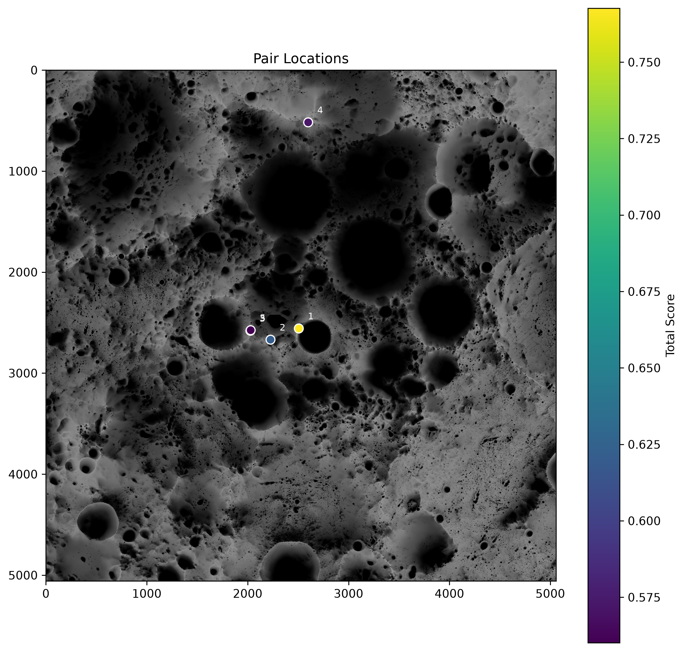

# ISRU Site-Selection-Engine
The ISRU Site-Selection Engine takes the NASA LOLA data for the Moon's south pole and
identifies candidate base locations from their proximity to cold traps and to well lit power
areas.

The two resources pull in opposite directions. Permanently shadowed regions (PSRs) hold the
volatiles worth mining, but they are cold and dark, while peaks of eternal light (PELs) offer
the illumination needed to power a base. A viable site has to sit close to both. The engine
derives both region classes from the illumination data, characterises them against elevation
and slope, pairs every PSR with the PELs within walking distance of it, and scores and ranks
those pairs.



**[Explore the results interactively](https://ahsaaant.github.io/ISRU-Site-Selection-Engine/)**:
change the thresholds and scoring weights and watch the top 3 sites move on a map of the south
pole (see [Website](#website)).
___
## Findings
At the default settings (`PEL_THRESHOLD` 55%, `FEASIBLE_DISTANCE` 2 km, equal weights), the
engine finds 62 PSR–PEL pairs. These are the top 3:

| Rank | Pair                   | Location (walk midpoint) | PSR area  | PEL sunlit | Walk    | Score | Nearest site in Wueller et al. (2026) [[1]](#references) |
| ---- | ---------------------- | ------------------------ | --------- | ---------- | ------- | ----- | --------------------------------------------- |
| 1    | `PSR_25131 to PEL_808` | 89.93° S, 216.1° E       | 1.87 km²  | 64.9%      | 1,342 m | 0.768 | CR08, Connecting Ridge, 8.6 km                |
| 2    | `PSR_27173 to PEL_897` | 89.34° S, 245.1° E       | 1.07 km²  | 62.1%      | 1,380 m | 0.621 | CRE02, Connecting Ridge Extension, 0.7 km     |
| 3    | `PSR_26090 to PEL_814` | 89.00° S, 264.1° E       | 0.054 km² | 62.5%      | 134 m   | 0.585 | CRE01, Connecting Ridge Extension, 0.8 km     |

The #1 site is near the rim of Shackleton crater, about 2 km from the pole. It is also the most
robust result: under equal weights it ranks first in 10 of the website's 16 threshold and
distance settings.

### 1. The engine picks small cold traps, not the big craters
None of the top sites are in the big crater PSRs, and size is not the reason. The engine labels
each crater's shadow as a single region, and every one of them passes the size filter. They
drop out for two other reasons:

| Crater     | PSR area  | Mean slope | Nearest PEL | Why it is excluded                       |
| ---------- | --------- | ---------- | ----------- | ---------------------------------------- |
| Shoemaker  | 1,085 km² | 9.1°       | 34 km       | No PEL within walking distance           |
| Haworth    | 1,029 km² | 9.7°       | 18 km       | No PEL within walking distance           |
| Faustini   | 668 km²   | 11.0°      | 4.3 km      | Slope filter, and no PEL within 2 km     |
| Sverdrup   | 556 km²   | 7.5°       | 6.5 km      | No PEL within walking distance           |
| Shackleton | 234 km²   | 26.8°      | 1.2 km      | Slope filter                             |

Each crater is the PSR region containing its centre. "Nearest PEL" is the shortest distance from
that region to a PEL above 55% that passes the filters. Even the website's longest distance, 5 km,
reaches only Faustini, which fails the slope filter anyway.

Shackleton is the only crater close enough. With the slope filter switched off for PSRs it would
rank first, but the part of it within 2 km of those PELs is the upper crater wall: 0.2–2.1 km² of
ground with a mean slope of 30–32°. Excluding it is the right call. LOLA measurements of the
crater by Zuber et al. (2012) also found that the brightness of its floor is best explained by
little ice building up since the crater formed [[2]](#references).

So the engine's sites are small PSRs of 0.05–2 km² on the ridges between the craters. The
literature supports that being where reachable ice is:

- **Hayne et al. (2021)** [[3]](#references) modelled cold traps from 1 km down to 1 cm across.
  These micro cold traps are the most numerous cold traps on the Moon and hold about 10–20% of
  the permanent cold-trap area for water, which the authors conclude may make polar ice more
  accessible to missions than previously thought.
- **Barker et al. (2023)** [[4]](#references) found that poleward of 80° S, PSRs smaller than
  1 km² hold 15 ± 5% of the total PSR area.
- **Wueller et al. (2026)** [[1]](#references) found the same around their landing sites: the
  median of the 141 PSRs within 2 km of the sites they assessed covers 6,116 m², under two of the
  engine's pixels.

### 2. Compared with Wueller et al. (2026)
Wueller et al. [[1]](#references) asked a close version of the same question: which landing sites
inside NASA's Artemis candidate regions have good illumination and potentially volatile-rich PSRs
within the 2 km walking limit. Their method differs from the engine's at almost every step.

|              | This engine                                              | Wueller et al. (2026)                                                          |
| ------------ | -------------------------------------------------------- | ------------------------------------------------------------------------------ |
| Search area  | All of 85–90° S                                          | The 16 Artemis candidate regions                                               |
| Light        | Average over the ~18.6-year illumination cycle, at 60 m  | Whether a site stays lit for a 6.5-day mission in each midsummer, 2025–2032    |
| Terrain      | Mean slope under 10° across each whole region            | The lander's landing requirements, including an 8° slope limit                 |
| Ice          | PSR area                                                 | Volatile estimates from Diviner temperatures and modelled crater ages          |
| Output       | Ranked PSR–PEL pairs                                     | 130 candidate landing sites, and the 141 PSRs within 2 km of the sites in four of the regions |

The comparison below uses their published landing sites and PSRs [[5]](#references), reprojected
onto the engine's grid. Each engine site is measured from its PEL, where a lander would set down.

**Where they agree**
- Sites #2 and #3 are 0.7 km and 0.8 km from their sites CRE02 and CRE01, in the Connecting Ridge
  Extension region, and both PSRs overlap PSRs that Wueller et al. assessed. The one under #2
  ranks 15th of 141 by their maximum volatile estimate. The one under #3 is among the 83 whose
  maximum estimate is not positive.
- At the 60% and 65% thresholds the engine's top site moves to Malapert Massif or Mons Mouton,
  0.3–0.9 km from their sites MMA_K2023 and MMO01.
- Across all 64 configurations on the website, 22 of the 58 distinct sites the engine puts in a
  top 3 have their PEL within 1 km of one of their landing sites.

**Where they disagree**
- The engine's #1 site is outside the ground their sites cover. The nearest, CR08 on Connecting
  Ridge, is 8.6 km away, and their map of ground meeting the lander's requirements has none within
  2 km of the engine's PEL.
- Most of their sites are not PELs to the engine. Of the 105 inside the engine's 85° S coverage,
  the median site is sunlit 44.8% of the time on the long-term map, and only 17 are on or beside a
  PEL at the 55% threshold. A crewed sortie needs light only for the 6.5 days it is there, which a
  site can have in the right midsummer despite a lower average. A base needs light all year, and
  the long-term average is what the engine measures.
- Most of their PSRs are too small for the engine to see. Only 12 of the 141 are larger than the
  engine's 10-pixel minimum, although those 12 hold 62% of the area, and 55 are smaller than a
  single 60 m pixel.

### 3. Compared with the Artemis III regions
NASA named 13 candidate regions for Artemis III in August 2022 [[6]](#references) and narrowed them
to nine in October 2024 [[7]](#references): Peak near Cabeus B, Haworth, Malapert Massif, Mons
Mouton Plateau, Mons Mouton, Nobile Rim 1, Nobile Rim 2, de Gerlache Rim 2, and Slater Plain.

The engine's default top 3 lie between the pole and Connecting Ridge Extension, around the
Connecting Ridge regions that were on the 2022 list but not the 2024 one. NASA says the cut
reflects the constraints of Artemis III itself, such as launch windows, communication, and
terrain, and does not mean the removed regions are unsuitable for later missions
[[8]](#references). The engine is built for a base supplied by local ice rather than a single
sortie, so the two lists are answering different questions.

The engine's top sites at the 60% and 65% thresholds, near Malapert Massif and Mons Mouton, are
both in regions on the 2024 list, although at 65% only 1 to 10 pairs are in range at all.

___
## How It Works
The pipeline in `src/Main.py` runs the following steps.

1. **Load rasters.** The illumination and altitude GeoTIFFs are read with `rasterio`.
2. **Resample to a common grid.** The 10 m/px altitude raster is reprojected onto the
   60 m/px illumination grid using average resampling, so that every layer shares one
   geometry. All later steps work in that 60 m grid.
3. **Convert altitude to elevation.** LOLA altitudes are radii from the Moon's centre, so the
   1,737,400 m reference sphere radius is subtracted to give elevation relative to that
   sphere.
4. **Scale illumination.** The raw illumination band is multiplied by its raster scale factor
   and converted to a percentage of time each pixel is sunlit.
5. **Derive slope.** The elevation gradient is taken in both axes using the true pixel
   spacing; slope is the arctangent of the gradient magnitude, in degrees.
6. **Label regions.** Pixels that are `NaN` in any layer are masked out. Illumination is then
   thresholded into PSRs and PELs, and each contiguous patch is labelled using
   8-connectivity, so that diagonal neighbours count as connected.
7. **Measure regions.** Each labelled region gets a pixel count and a row in a table holding
   its mean illumination, elevation, and slope.
8. **Filter by size.** Regions below a minimum pixel count are separated out, so that
   single-pixel noise does not reach the analysis.
9. **Filter by slope.** Regions whose mean slope is at or above the slope threshold are
   separated out, since they are unsuitable for landing and construction.
10. **Pair regions.** For each PEL, a Euclidean distance transform gives the distance in metres
    from every pixel to that PEL, measured between pixel centres. Every PSR whose nearest pixel
    is within the feasible distance is paired with it.
11. **Score pairs.** Each pair is scored on distance, PEL illumination, and PSR size, and the
    pairs are ranked from best to worst (see [Scoring](#scoring)).
12. **Plot.** The input layers, a score breakdown of the top 5 pairs, and a map of where those
    pairs sit are written to `output/` (see [Outputs](#outputs)).

### Scoring
Each criterion is scaled to a 0–1 score, where 1 is best:
| Score        | Calculation                                                                                         |
| ------------ | --------------------------------------------------------------------------------------------------- |
| Distance     | `1 - distance / FEASIBLE_DISTANCE`, so a closer pair scores higher and one at the limit scores 0. Distances run between pixel centres, so even touching regions are 60 m apart and score just under 1. |
| Illumination | The PEL's mean illumination, min-max scaled from `PEL_THRESHOLD` up to the brightest paired PEL.     |
| Size         | The log of the PSR's pixel count, min-max scaled across all pairs.                                  |

The total score is the weighted mean of the three, using `DISTANCE_WEIGHT`,
`ILLUMINATION_WEIGHT`, and `SIZE_WEIGHT`. The `distance_score`, `illumination_score`, and
`size_score` columns in the output table hold each score after its weight is applied, so they
only stay in the 0–1 range while the weights are 1. The table also records what percentage of
each pair's total comes from each criterion.

Illumination and size are scaled against the other pairs in the same run, so a score compares
a pair with the other candidates and is not an absolute measure.

### Tunable Parameters
| Parameter               | Location                | Current value | Meaning                                                                                                                                                      |
| ----------------------- | ----------------------- | ------------- | ------------------------------------------------------------------------------------------------------------------------------------------------------------ |
| `PSR_THRESHOLD`         | `src/Main.py`           | `0`           | A pixel is part of a PSR at or below this illumination percentage.                                                                                           |
| `PEL_THRESHOLD`         | `src/Main.py`           | `55`          | A pixel is part of a PEL above this illumination percentage.                                                                                                 |
| `PIXEL_SIZE`            | `src/Main.py`           | `60`          | The side length of each pixel, in metres. One pixel covers 3,600 m².                                                                                         |
| `REGION_SIZE_THRESHOLD` | `src/Main.py`           | `10`          | Regions of 10 pixels or fewer are omitted.                                                                                                                   |
| `SLOPE_THRESHOLD`       | `src/Main.py`           | `10`          | A region is considered only if its mean slope is below this value, in degrees.                                                                               |
| `FEASIBLE_DISTANCE`     | `src/Main.py`           | `2000`        | The maximum PSR to PEL distance for a pair, in metres. This is the radial limit for astronauts without a rover, from Wueller et al. (2026) [[1]](#references). |
| `DISTANCE_WEIGHT`       | `src/Main.py`           | `1.0`         | The weight that distance holds in the final pair score.                                                                                                      |
| `ILLUMINATION_WEIGHT`   | `src/Main.py`           | `1.0`         | The weight that PEL illumination holds in the final pair score.                                                                                              |
| `SIZE_WEIGHT`           | `src/Main.py`           | `1.0`         | The weight that PSR size holds in the final pair score.                                                                                                      |
| `ALTITUDE_OFFSET`       | `src/FileProcessing.py` | `1737400`     | LOLA reference sphere radius, in metres.                                                                                                                     |
| `TOP_N_PAIRS`           | `src/Main.py`            | `5`          | The amount of pairs to plot with the top scores.  |

---

## Project Structure
```
.
├── data/                  # Rasters and QGIS project (untracked — see Data)
├── output/                # Generated plots (untracked — created on each run)
├── src/
│   ├── Main.py            # Pipeline wiring, file paths, thresholds, and weights
│   ├── FileProcessing.py  # Raster I/O, resampling, unit conversion, and slope
│   ├── Regions.py         # Validity mask, labelling, region statistics, distances, filtering
│   ├── Analysis.py        # PSR to PEL pairing and pair scoring
│   ├── Display.py         # Layer plots, score chart, and pair location map
│   └── WebExport.py       # Precomputes the website's results and basemap tiles
├── docs/                  # The website, served by GitHub Pages
│   ├── index.html         # Page structure and the How It Works text
│   ├── style.css
│   ├── app.js             # Controls, site cards, and the map
│   ├── data/results.js    # Generated by WebExport.py: every configuration's top 3 sites
│   ├── data/reference.js  # The candidate landing sites of Wueller et al. (2026)
│   └── tiles/             # Generated by WebExport.py: the basemap tile pyramid
├── Requirements.txt
└── README.md
```

`Regions.py`, `Analysis.py`, and `Display.py` each carry a `__main__` block that runs their
functions on small hand-made arrays, which is the quickest way to see what an individual
function returns. The `__main__` block in `FileProcessing.py` runs the loading steps on the
real rasters, so it needs the files in `data/`, and it prints nothing.

---

## Setup
Built against Python 3.13.

```bash
python3 -m venv .venv
source .venv/bin/activate
pip install -r Requirements.txt
```

Note the capital `R` in `Requirements.txt`. The file is a full freeze of the environment; the
direct dependencies are `rasterio`, `numpy`, `scipy`, `pandas`, and `matplotlib`, plus `pillow`,
which only `WebExport.py` uses.

---

## Data
The rasters are large and are not tracked in this repository. `data/` is gitignored, so a
fresh clone has no inputs and the pipeline will not run until they are put in place.

### Sources
1. [LOLA Illumination (ABGVIS_85S_060M_201608)](https://pgda.gsfc.nasa.gov/products/69) —
   average sun visibility of each 60 m × 60 m pixel, from 85°S to the south pole, computed over
   the ~18.6-year lunar nutation cycle as described by Mazarico et al. (2011)
   [[10]](#references).
2. [LOLA DEM (LDEM_85S_10M_FLOAT)](https://pds-geosciences.wustl.edu/lro/lro-l-lola-3-rdr-v1/lrolol_1xxx/data/lola_gdr/polar/float_img/) —
   altitude of each 10 m × 10 m pixel, from 85°S to the south pole, measured by the Lunar Orbiter
   Laser Altimeter [[11]](#references).

The comparison in [Findings](#findings) also uses the candidate landing sites and PSRs that
Wueller et al. (2026) published on Zenodo [[5]](#references), under CC BY 4.0. Their 130 sites are
included in `docs/data/reference.js`, converted to the engine's polar stereographic metres, so the
website can show them.

### Preparation
The DEM needs a conversion step before the pipeline can use it. LOLA distributes its values in
kilometres while the pixel spacing is in metres, and slope is meaningless until the two agree.

1. Download both products.
2. Open the DEM in QGIS and convert its values from kilometres to metres. `data/Moon.qgz` is
   the QGIS project used for this.
3. Export the result as a GeoTIFF.
4. Place the files in `data/` under the exact names the pipeline expects:
   - `data/Altitude-rasterize.tif`
   - `data/SunVisibility(abgvis_85S_060M_201608).tiff`

The exported altitudes are still radii measured from the Moon's centre. Step 3 of the pipeline
converts them to elevations relative to the 1,737.4 km reference sphere — the perfectly smooth
average radius of the Moon used as the standard datum.

---

## Usage
```bash
python src/Main.py
```

Run this from the repository root. `Main.py` refers to its inputs and outputs as `data/...` and
`output/...` relative to the working directory, so running it from inside `src/` will fail to
find the rasters.

The run prints the scored pair table, ranked from best to worst, saves the plots below, and
opens them in matplotlib windows. The five layer plots open together, then the score chart,
then the pair map; close each set of windows to let the run continue.

Each row of the table is indexed by a pair ID of the form `PSR_<id> to PEL_<id>`, where the
IDs match the labels in the PSR and PEL region plots. The columns are the pair's `distance`
(m), `PEL_illumination` (%), and `PSR_size` (pixels), followed by the three criterion scores,
the `total_score`, and the percentage that each criterion contributes to the total.

### Outputs
| File                          | Contents                                                                                     |
| ----------------------------- | -------------------------------------------------------------------------------------------- |
| `output/plots/*.png`          | The elevation, illumination, slope, PSR region, and PEL region layers.                       |
| `output/scored_data.png`      | A stacked bar chart of the top 5 pairs, split into the contribution of each criterion.       |
| `output/pair_locations.png`   | The top 5 pairs on the illumination map, each joined at its closest points and marked at the midpoint, coloured by total score. |

`output/` is gitignored and is created on the first run.

---

## Website
`docs/` holds a static website that presents the results interactively. Choose a PEL threshold, a
feasible distance, and a scoring priority, and the top 3 sites update on a zoomable map of the
south pole, with each site's PSR, PEL, and the shortest walk between them drawn in. Every
configuration has its own URL, so a particular view can be shared.

The map can also show the 130 candidate landing sites from Wueller et al. (2026)
[[1]](#references), marked by whether their region is one of the nine NASA kept for Artemis III,
and each site card names the nearest of them. Below the map, the page carries a write-up of the
project: why it was made, how the engine works, and the findings above.

The site never runs the engine. `src/WebExport.py` runs the same steps as `Main.py` for every
combination of the options below, and writes the top 3 sites of each to
`docs/data/results.js`, along with the basemap tiles in `docs/tiles/`. That makes the 64
configurations instant to switch between. It also records where each of those sites' PSRs ranks
in every configuration, so each site card can show how the site holds up when the threshold
and distance change.

| Option              | Values                                                                                           |
| ------------------- | ------------------------------------------------------------------------------------------------ |
| `PEL_THRESHOLD`     | `50`, `55`, `60`, `65` (%)                                                                       |
| `FEASIBLE_DISTANCE` | `1000`, `2000`, `3000`, `5000` (m)                                                               |
| Scoring priority    | Balanced (all weights 1), Power first (illumination ×3), Short traverse (distance ×3), Largest cold trap (size ×3) |

Every other constant comes from `src/Main.py`. To change the options, edit the lists at the top of
`WebExport.py`, then run it from the repository root:

```bash
python src/WebExport.py
```

To view the site locally, open `docs/index.html` in a browser, or serve the folder with
`python -m http.server --directory docs` and visit `http://localhost:8000`. The page loads
Leaflet from a CDN, so it needs an internet connection either way.

To publish it, open the repository's **Settings → Pages**, choose **Deploy from a branch**, and
select the default branch and the `/docs` folder.

---

## Limitations
The data has a resolution of 60 m, so each pixel averages 3,600 m² of terrain. That can smooth
over rough ground and dilute the brightest PELs. It also hides the smallest cold traps. Hayne et
al. (2021) find cold traps down to 1 cm across [[3]](#references), and 55 of the 141 PSRs that
Wueller et al. (2026) assessed are smaller than one pixel [[1]](#references), so the engine misses
PSRs that may hold real ice.

Illumination is the long-term average at ground level. A short crewed mission only needs light
while it is there, so the engine understates sites that are well lit in the right midsummer (see
[the comparison](#2-compared-with-wueller-et-al-2026)). Solar panels on a mast also see more light
than the ground: Gläser et al. (2014) model Connecting Ridge as sunlit 92.27% of the time at 2 m
above the surface and 95.65% at 10 m [[9]](#references).

The slope filter uses the mean slope of a whole region at 60 m. That is coarser than a lander's own
limits, and for a PSR it measures the whole crater rather than the part a walk can reach.

The scoring only considers PEL illumination, PSR size, and the distance between the two. It does
not estimate how much ice a PSR holds, which depends on its temperature and age
[[1]](#references). It also leaves out scientific value, ease of communication between the site
and Earth, and other factors that affect how desirable a site is. For example, part of the reason
Artemis is focused on the south pole is the South Pole–Aitken basin, an ancient impact basin with
Shackleton crater on its rim. Samples from the basin could help us understand the interior makeup
of the Moon.

---

## References
1. Wueller, L., Berger, L. M., Christopher, H., Sugimoto, K., Thaker, A. D., Carton, L., Jo, W.,
   Lee, S., Pedrelli, R., Sanchez, P., & Kring, D. A. (2026). Assessing potential landing sites
   with favorable illumination and accessible, potentially volatile-rich permanently shadowed
   regions within Artemis candidate landing regions. *Journal of Geophysical Research: Planets*,
   131, e2025JE009434. https://doi.org/10.1029/2025JE009434
2. Zuber, M. T., et al. (2012). Constraints on the volatile distribution within Shackleton crater
   at the lunar south pole. *Nature*, 486, 378–381. https://doi.org/10.1038/nature11216
3. Hayne, P. O., Aharonson, O., & Schörghofer, N. (2021). Micro cold traps on the Moon. *Nature
   Astronomy*, 5, 169–175. https://doi.org/10.1038/s41550-020-1198-9
4. Barker, M. K., et al. (2023). A new view of the lunar south pole from the Lunar Orbiter Laser
   Altimeter (LOLA). *The Planetary Science Journal*, 4, 183. https://doi.org/10.3847/PSJ/acf3e1
5. Wueller, L., et al. (2025). Complementary data for Wueller et al. (2026) [Data set]. Zenodo.
   https://doi.org/10.5281/zenodo.17084058
6. NASA. (2022, August 19). NASA identifies candidate regions for landing next Americans on Moon.
   https://www.nasa.gov/news-release/nasa-identifies-candidate-regions-for-landing-next-americans-on-moon/
7. NASA. (2024, October 28). NASA provides update on Artemis III Moon landing regions.
   https://www.nasa.gov/news-release/nasa-provides-update-on-artemis-iii-moon-landing-regions/
8. George, T., Rubio, M. A., Lawrence, S. J., & Curell, P. (2026). Artemis III site selection
   update: Downselection from thirteen to nine candidate regions. Lunar and Planetary Science
   Conference. https://ntrs.nasa.gov/citations/20250011660
9. Gläser, P., et al. (2014). Illumination conditions at the lunar south pole using high
   resolution Digital Terrain Models from LOLA. *Icarus*, 243, 78–90.
   https://doi.org/10.1016/j.icarus.2014.08.013
10. Mazarico, E., et al. (2011). Illumination conditions of the lunar polar regions using LOLA
    topography. *Icarus*, 211, 1066–1081. https://doi.org/10.1016/j.icarus.2010.10.030
11. Smith, D. E., et al. (2010). The Lunar Orbiter Laser Altimeter investigation on the Lunar
    Reconnaissance Orbiter mission. *Space Science Reviews*, 150, 209–241.
    https://doi.org/10.1007/s11214-009-9512-y 